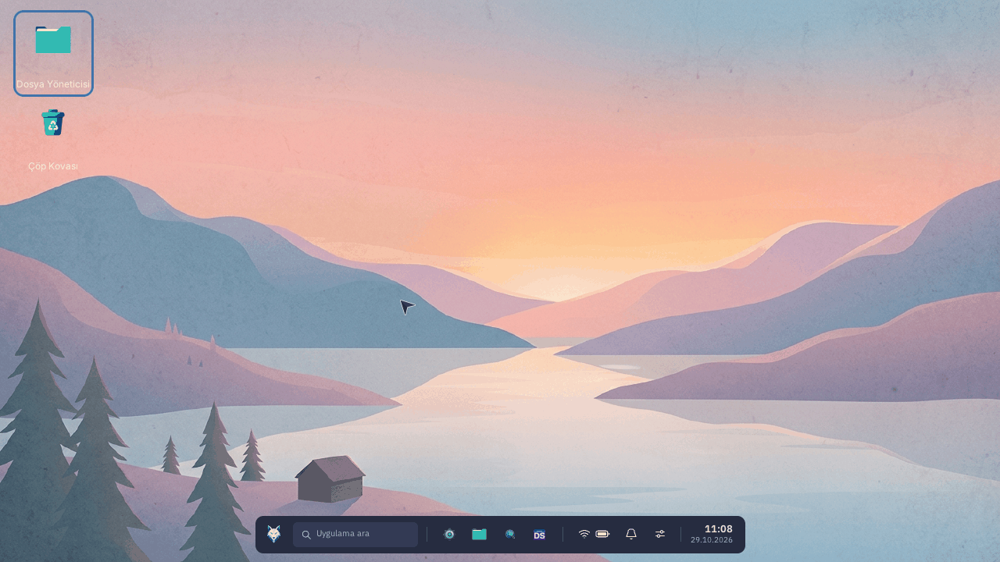
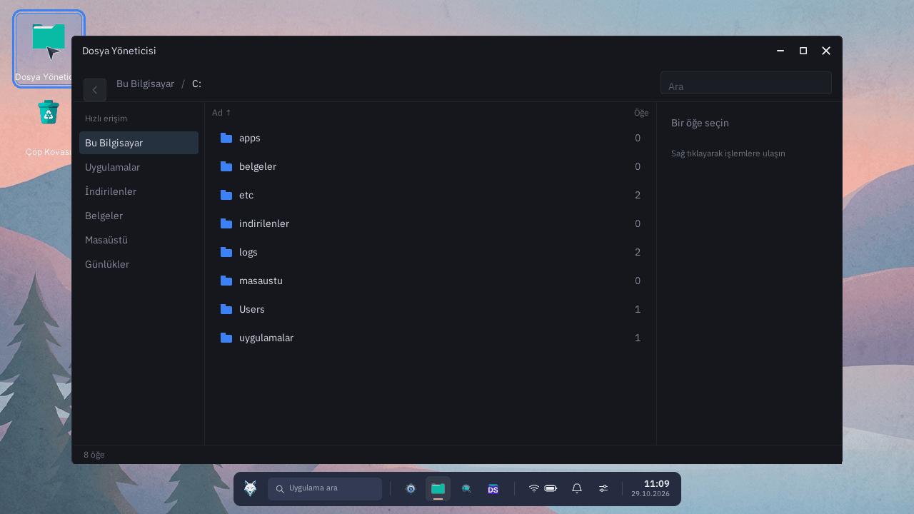
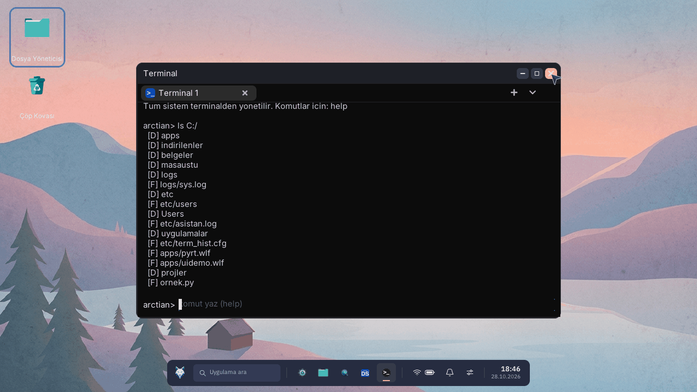

# Arctian OS

x86_64 için sıfırdan yazılmış, modüler bir masaüstü işletim sistemi. Kendi önyükleyicisi,
kendi çekirdeği, kendi dosya sistemi (AFS), kendi TCP/IP yığını ve LVGL tabanlı bir masaüstü
kabuğu vardır. Üçüncü parti bir mikroişletimci veya libc kullanılmaz.

**Sürüm: 0.7** — tek kaynak [`version.json`](version.json).



---

## Neler çalışıyor

| Alan | Durum |
|---|---|
| Önyükleme | MBR (USB/CD) + El Torito ISO, VESA/Bochs VBE ile çerçeve tamponu, 64-bit uzun mod |
| Modüller | `boot` → `main_kernel` → `install` → `kernel_plus` → `desktop`; her biri sabit adresli bağımsız `.bin` |
| Masaüstü | Dock, başlat menüsü, gerçek arama, pencereler (taşıma/yakınlaştırma/boyut hatırlama), sanal masaüstleri, hızlı ayarlar + OSD, bildirim merkezi, gece modu, kurulum sihirbazı, çoklu hesap, kilit ekranı |
| Uygulamalar | Terminal, Dosya Yöneticisi, Tarayıcı (iki motor: Wolf Engine ve Lexbor), DuckStore, Ayarlar, Medya Oynatıcı, Görev Yöneticisi, Sistem Araçları, Çöp Kovası, Asistan (gömülü); `.wlf` olarak kurulan üçüncü parti uygulamalar |
| Dosya sistemi | AFS v4 (`C:/`), FAT32, ISO9660, USB MSD; fsck benzeri bütünlük denetimi, AES-XTS disk şifreleme |
| Ağ | ARP/IPv4/TCP/UDP + DHCP, DNS, HTTP/HTTPS (mbedTLS), NTP, uygulama seviyesi güvenlik duvarı |
| Sürücüler | e1000, PCnet, RTL8139, RTL8169, Atheros ath9k, Intel AX201 (iskelet), USB UHCI/EHCI/XHCI + HID + MSD, AHCI/ATA/ATAPI/NVMe, AC'97 ses, PS/2 klavye-fare, CMOS RTC, ACPI (Güç Kapat / uyku durumları), VESA |
| Uygulama modeli | **Her uygulama bir `.wlf`'tir** (gömülü çekirdek uygulamalar hariç); roller: `ui`, `cli`, `runtime`; dosya uzantısı eşlemesi ("birlikte aç") |
| Güvenlik | Yetenek maskesi + dosya kapısı + komut kapısı + kullanıcı onay penceresi + karar deposu; RSA-2048/SHA-256 paket ve manifesto imzası |
| Güncelleme | İmzalı sürüm manifestosu, kapanışta/açılışta kurulum, A/B sistem yuvası ve geri dönüş |
| Mağaza | DuckStore: Python feed + web market sunucusu, OS istemcisi, `wf` komut satırı aracı |

Ekran görüntüleri QEMU'dan alınmıştır (1280×720, varsayılan açılış çözünürlüğü).





## Hızlı başlangıç

Windows'ta tek adım (WSL + Debian üzerinden derler):

```bat
build.bat
```

Derleme bittiğinde:

```
build\arctian.iso    <- USB / CD / kalıp için (CD001, El Torito önyüklenebilir)
build\arctian.img    <- ham disk imaji
```

ISO'yu QEMU'da denemek için:

```sh
make qemu-iso
# veya
qemu-system-x86_64 -cdrom build/arctian.iso -boot d -m 512M -vga std
```

Kurulumdan başka bir şey yapmana gerek yok: ISO önyüklendiğinde önyükleme menüsü
("Kur / Dene") gelir. Ayrıntılar: [docs/derleme.md](docs/derleme.md)

## Kendi uygulamanı yazmak

`.wlf` bir uygulamayı derlemek için `wf` yeterli:

```sh
cd sdk/examples/merhaba
../../wf build merhaba
```

SDK, örnekler ve çalışma zamanı arayüzü (`wolf_api_t`) için:
[sdk/README.md](sdk/README.md) · C uygulaması API referansı:
[docs/uygulama-gelistirme.md](docs/uygulama-gelistirme.md)

## Depo yapısı

```
boot/          stage1 (MBR), stage1_iso (El Torito), stage2 — NASM
main_kernel/   GDT/IDT, sayfalama, modül yükleyici, syscall, ring3 iskeleti
install/       kurulum sihirbazı (disk bölümleme + AFS biçimlendirme + kalıp)
kernel_plus/   sürücüler, ağ yığını, zamanlayıcı/işlemci/iplik, yetenek kapıları, TLS
desktop/       masaüstü kabuğu (LVGL), uygulamalar, .wlf yükleyici/VM, tema
lib/           AFS, FAT32, ISO9660, blok katmanı, ses/medya, PNG/SVG, malloc, printf
include/       kamu başlıkları (asi.h, app.h, wlf.h, memory_map.h, ...)
sdk/           libWolf SDK, wf CLI, örnek uygulamalar
store/         DuckStore sunucusu (feed + web market) ve dağıtım dosyaları
tools/         paketleme, imzalama, font/duvar kağıdı üretimi, QEMU yardımcıları
design/        arayüz şartnamesi ve görseller (kurulum ekranı HTML'i derleme girdisidir)
third_party/   LVGL, mbedTLS, QuickJS, Lexbor (vendored — bkz. third_party/README.md)
docs/          mimari, derleme, uygulama geliştirme
```

## Belgeler

- [docs/mimari.md](docs/mimari.md) — modüller, bellek haritası, önyükleme akışı, AFS,
  `.wlf` modeli, yetenek ve imza modeli
- [docs/derleme.md](docs/derleme.md) — gereken araçlar, `make` hedefleri, ISO doğrulaması,
  QEMU ile çalıştırma, hata ayıklama varyantları
- [docs/uygulama-gelistirme.md](docs/uygulama-gelistirme.md) — C uygulama API'sinin tamamı
  (ASI, LVGL, fs/net/audio/güç/mağaza) ve tam örnekler
- [CHANGELOG.md](CHANGELOG.md) — sürüm kayıtları

## Bilinen sınırlar

- **Uygulamalar kabukla aynı adres alanında çalışır.** Yetenek kapıları, dosya/komut
  kapıları ve onay penceresi bir *politika* sınırıdır; donanımsal (ring 3 + ayrı sayfa
  tablosu) izolasyon henüz yok. Hedeflenen tasarım mimari belgesinde açıkça yazılı.
- Tek çekirdekli çalışır; zamanlayıcı tik'iyle işleyen küçük bir planlayıcı vardır (en
  fazla 8 görev).
- Intel AX201 sürücüsü donanım testi bekliyor; ath9k (AR928x) uçtan uca çalışıyor.
- Windows üzerinde yerel `.wlf` derlemesi yok (ELF bağlayıcısı gerekiyor); Linux/WSL
  tarafında `wf` ile derlenir.
- Depodaki imza anahtarı `tools/keys/dev_rsa2048.txt` bir **geliştirme** anahtarıdır;
  yayın öncesi `tools/sig_keygen.py` ile yenisi üretilmelidir.

## Lisans

Apache License 2.0 — tam metin: [LICENSE](LICENSE).
`third_party/` altındaki LVGL (MIT) ve mbedTLS (Apache-2.0) kendi lisanslarıyla gelir;
bkz. [third_party/README.md](third_party/README.md).
